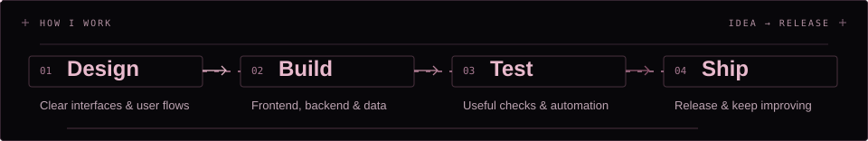
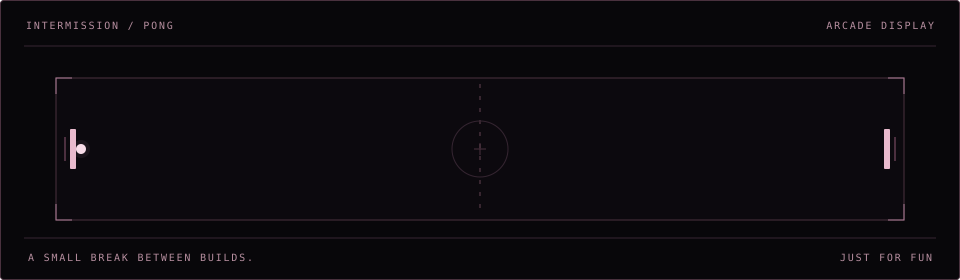

<!-- Custom name artwork is stored in this repository; static variants respect reduced motion. -->
<picture>
  <source media="(prefers-reduced-motion: reduce)" srcset="./assets/name-header-clear-static.svg" />
  
</picture>

  <picture>
    <source media="(prefers-reduced-motion: reduce)" srcset="./assets/greeting-static.svg" />
    
  </picture>

  

## How I work

<picture>
  <source media="(prefers-reduced-motion: reduce) and (max-width: 600px)" srcset="./assets/workflow-mobile.svg" />
  <source media="(prefers-reduced-motion: reduce)" srcset="./assets/workflow.svg" />
  <source media="(max-width: 600px)" srcset="./assets/workflow-mobile-motion.svg" />
  
</picture>

## Selected work

<!-- Project cover illustrations represent each project's focus; they are not product screenshots. -->
<a href="https://dentalclinic-dava.vercel.app">
  <picture>
    <source media="(prefers-reduced-motion: reduce)" srcset="./assets/project-dava.svg" />
    
  </picture>
</a>

A dental practice website with an interactive 3D introduction and a WhatsApp appointment planner.
`Next.js` · `TypeScript` · `React Three Fiber` · `Prisma`

[Open live site ↗](https://dentalclinic-dava.vercel.app) · [View repository](https://github.com/naufaldzakwann/dentalclinic-dava)

<a href="https://porto-ten-tau.vercel.app/#work">
  <picture>
    <source media="(prefers-reduced-motion: reduce)" srcset="./assets/project-container.svg" />
    
  </picture>
</a>

A Firefox extension for targeted click automation across container tabs, with per-tab controls and a shared dashboard.
`JavaScript` · `Firefox WebExtensions API` · `HTML` · `CSS`

[Explore project ↗](https://porto-ten-tau.vercel.app/#work)

<a href="https://porto-ten-tau.vercel.app/#work">
  <picture>
    <source media="(prefers-reduced-motion: reduce)" srcset="./assets/project-lambe.svg" />
    
  </picture>
</a>

An on-device social app prototype for discussions, discovery, and communities.
`Expo` · `React Native` · `TypeScript` · `React Navigation`

[Explore project ↗](https://porto-ten-tau.vercel.app/#work)

[More projects and design work on my portfolio →](https://porto-ten-tau.vercel.app)

## Tech stack

  

**Languages**

  
  
  
  
  
  
  
  

**Web & interface design**

  
  
  
  
  
  
  
  

**Backend & data**

  
  
  
  
  
  
  
  
  
  

**Testing & automation**

  
  
  
  
  

**Development & delivery**

  
  
  
  
  

<b>Mobile, desktop & more from my projects</b>

  
  
  
  
  
  

Data access: **Prisma · SQLAlchemy · Drizzle · TypeORM · MariaDB**.

Also used across individual projects: **Framer Motion · Rust · GDScript · Blender · FFmpeg**.

## Intermission

<picture>
  <source media="(prefers-reduced-motion: reduce)" srcset="./assets/arcade-pong-static.svg" />
  
</picture>

## Around GitHub

[Browse my repositories](https://github.com/naufaldzakwann?tab=repositories) · [View contribution activity](https://github.com/naufaldzakwann?tab=overview)

  
  

  

Watch the contribution trail

<!-- Generated daily by the existing snake workflow; the last successful SVG stays available. -->
<picture>
  <source media="(prefers-color-scheme: dark)" srcset="https://raw.githubusercontent.com/naufaldzakwann/naufaldzakwann/output/github-contribution-grid-snake-dark.svg" />
  
</picture>

