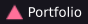
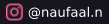
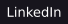
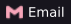

<!-- Custom name artwork is stored in this repository; static variants respect reduced motion. -->
<picture>
  <source media="(prefers-reduced-motion: reduce)" srcset="./assets/name-header-static.svg" />
  
</picture>

  <picture>
    <source media="(prefers-reduced-motion: reduce)" srcset="./assets/greeting-static.svg" />
    
  </picture>

## About me

I'm Naufal, based in Semarang, Indonesia. I build web applications with Next.js, React, and Laravel, and use Python for automation. My work also covers UI/UX design in Figma and testing features before release.

  
  
  
  

## Tech stack

**Languages**

  
  
  
  
  
  
  
  

**Web & interface design**

  
  
  
  
  
  
  
  

**Backend & data**

  
  
  
  
  
  
  
  
  
  

**Testing & automation**

  
  
  
  
  

**Development & delivery**

  
  
  
  
  

<b>Mobile, desktop & more from my projects</b>

  
  
  
  
  
  

Data access: **Prisma · SQLAlchemy · Drizzle · TypeORM · MariaDB**.

Also used across individual projects: **Framer Motion · Rust · GDScript · Blender · FFmpeg**.

## Selected work

**[Dava Dental Care](https://github.com/naufaldzakwann/dentalclinic-dava)** 
A dental practice website with an interactive 3D introduction and a WhatsApp appointment planner. 
`Next.js` · `TypeScript` · `React Three Fiber` · `Prisma`

**[Violet Global Indonesia](https://github.com/naufaldzakwann/violet-global-indonesia-web-profile)** 
A company website presenting technology, consulting, cybersecurity, and energy services. 
`Next.js` · `React` · `Tailwind CSS` · `GSAP`

**[Threads Bot](https://github.com/naufaldzakwann/threads-bot)** 
A desktop workspace for managing Threads accounts and scheduling posts. 
`Python` · `FastAPI` · `Electron` · `React`

**[PBO-GAME](https://github.com/naufaldzakwann/PBO-GAME)** 
A Java Swing brick-breaker game with keyboard controls and scoring. 
`Java` · `Swing` · `OOP`

[More projects and design work on my portfolio →](https://porto-ten-tau.vercel.app)

## Around GitHub

[Browse my repositories](https://github.com/naufaldzakwann?tab=repositories) · [View contribution activity](https://github.com/naufaldzakwann?tab=overview)

Watch the contribution trail

<!-- Generated daily by the existing snake workflow; the last successful SVG stays available. -->
<picture>
  <source media="(prefers-color-scheme: dark)" srcset="https://raw.githubusercontent.com/naufaldzakwann/naufaldzakwann/output/github-contribution-grid-snake-dark.svg" />
  
</picture>

---

Have a project in mind? [Email me](mailto:naufal.dzakwan91@gmail.com) or find me on [Instagram](https://www.instagram.com/naufaal.n/) and [LinkedIn](https://www.linkedin.com/in/naufaldzakwannn/).
